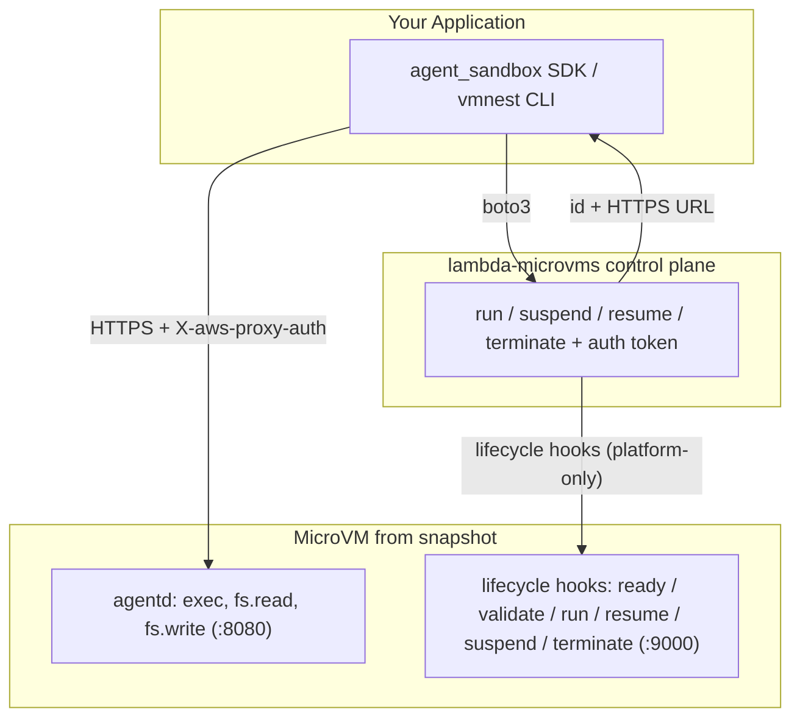

<div align="center">


# agent-microvm

**Isolated AWS microVM sandboxes for AI agents.**

Python SDK · CLI · MCP server · AWS microVMs

[](https://github.com/jnh12/agent-microvm/stargazers)
[](LICENSE)
[](https://pypi.org/project/vmnest/)
[](https://www.python.org/downloads/)

[Quick start](#quick-start) · [Documentation](DOCUMENTATION.md) · [MCP setup](DOCUMENTATION.md#use-it-from-an-ai-agent-mcp) · [Contributing](CONTRIBUTING.md)

</div>

Run untrusted AI-generated code, user submissions, and CI jobs in
[**AWS Lambda MicroVMs**](https://aws.amazon.com/lambda/lambda-microvms/).
Each Firecracker sandbox provides VM-level isolation, snapshot-based startup,
a dedicated HTTPS endpoint, and suspend/resume for up to 8 hours.
Infrastructure is provisioned with **bare `boto3`**, without an external IaC engine.

## Quick start

Requires Python 3.11+, configured AWS credentials, and access to Lambda MicroVMs
in your chosen region. In a fresh directory (Bash):

```bash
python3 -m venv .venv
source .venv/bin/activate
pip install "vmnest[mcp]"
vmnest infra init
# Edit sandbox.yaml: choose your region and resource settings.
export AWS_DEFAULT_REGION=us-east-1  # match region in sandbox.yaml
vmnest infra preview
vmnest infra up

vmnest create app
vmnest exec app -- python -c "print('Hello from a microVM!')"
vmnest rm app                       # terminate the sandbox when finished
```

The package includes the guest image source; AWS builds the image. Docker is
only needed for local guest tests. `vmnest create` reads image/role ARNs from
infra outputs; the Python SDK needs explicit arguments or environment variables.

Use `vmnest stop app` / `vmnest start app` to suspend/resume a sandbox before
removing it. To remove managed infrastructure afterward, run `vmnest infra destroy`.
For an existing checkout or other installation options, see
[setup](DOCUMENTATION.md#1-install-the-sdkcli).

## Demo

**Install and provision** — install `vmnest[mcp]`, configure `sandbox.yaml`,
then run `vmnest infra up` to build the image and provision resources:


**Boot and serve an app** — create a sandbox, start FastAPI with `vmnest exec`,
then use `vmnest forward` to reach it on localhost:


## Architecture



## Documentation

[Read the full guide](DOCUMENTATION.md) for setup and reference:

- [Infrastructure and configuration](DOCUMENTATION.md#2-configure-and-deploy-the-infrastructure)
- [Python SDK](DOCUMENTATION.md#3-use-the-sdk) · [CLI](DOCUMENTATION.md#4-use-the-vmnest-cli)
- [MCP installation, clients, and tools](DOCUMENTATION.md#use-it-from-an-ai-agent-mcp)
- [Networking](DOCUMENTATION.md#networking) · [Local web apps](DOCUMENTATION.md#5-serve-a-web-app-from-a-sandbox)
- [Environment variables](DOCUMENTATION.md#environment-variables) · [Custom images](DOCUMENTATION.md#bring-your-own-guest-image)
- [Troubleshooting](DOCUMENTATION.md#troubleshooting) · [Limitations](DOCUMENTATION.md#status--not-yet-implemented)

[Contributing](CONTRIBUTING.md) · [Apache-2.0 license](LICENSE)
